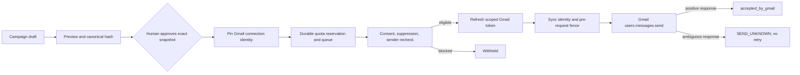

# Emar architecture — 0.3.0-beta.0

## Scope and ownership

Emar owns campaign execution state, immutable approval snapshots, the send queue, tracking events, a suppression projection, provider connection records, and execution DAG state. REST and MCP use trusted tenant/business scope supplied by the host Identity adapter; caller-supplied scope fields are rejected.

| Owner | Emar contract |
|---|---|
| Zuri Identity | Supplies authenticated actor, tenant/business membership, permissions, and human-vs-agent type through an injected authorizer. |
| Zuri CRM | Supplies contact, `EMAIL_MARKETING` consent, suppression, reply, and bounce projections through scoped methods. |
| Zuri Marketing | Owns plans and source campaign content; Emar stores a versioned execution template and exact approved snapshot. |
| Zuri Files | Owns bytes and file metadata. Emar stores `fileRef`, SHA-256, MIME type, filename, size, and version; the send adapter resolves bytes and checks the approved hash. |
| Google OAuth | Authenticates the Gmail account linked to the local Emar operator. Gmail credentials are encrypted in Emar's local durable store. |

The existing `emailmar` source paths, compatibility exports, local scope IDs, and `EMAILMAR_*` configuration aliases remain. Public service, package, UI, health, and MCP names are Emar 0.3.0-beta.0.

## Durable state

SQLite at `data/emar.sqlite` is the default. `SqliteStore` owns the file exclusively for one service process, enables WAL and full synchronous commits, persists its state snapshot, and fails closed after a storage error. `EMAR_STORAGE=memory` explicitly selects the in-memory fixture adapter. Both stores expose the same domain maps, including Gmail connections and DAG runs.

The durable boundary includes templates, contacts/consent, suppression, campaign snapshots, queue and idempotency state, quota, tracking events, audit, encrypted Gmail connection records, and DAG runs. Database state transitions and their audit entries are checkpointed before provider side effects. A persisted `sending` entry is recovered as `SEND_UNKNOWN`; Emar accounts conservatively and does not resend it automatically. No distributed multi-host queue is provided.

The database contains encrypted OAuth token bundles. Its `EMAR_TOKEN_ENCRYPTION_KEY` is separate process configuration and must be backed up with the database. The service does not log the key or return it in browser responses. Back up both before deleting or moving the database.

## Campaign approval and send lifecycle

The immutable approval snapshot includes template id/version/content, campaign name, recipient IDs and exact addresses/variables, attachment metadata/hash/reference, and the connected Gmail sender identity (`connectionId`, verified Google subject, and verified email). A missing sender is pinned as empty; connecting or changing accounts requires a fresh approval.

The queue key is stable for `(campaign, snapshot hash, recipient)`. Quota, tracking references, send intent, and audit are durable before Gmail is called. Immediately before the HTTP request, the adapter checks that the sender still matches the approved identity and invokes the domain's synchronous eligibility/pause fence after token refresh. A missing/disconnected/changed sender or failed pre-request fence cannot consume a queue entry or start Gmail I/O. A timeout or ambiguous provider response becomes `SEND_UNKNOWN` and requires manual reconciliation; no automatic resend exists.

Eligibility requires `EMAIL_MARKETING` consent with status `GRANTED`. Any suppression projection wins. Eligibility is rechecked when scheduling and immediately before provider I/O. A changed address, content, attachment, or Gmail sender requires a new human-approved snapshot.

## Gmail OAuth and security

OAuth is configured through process environment: `EMAR_GOOGLE_CLIENT_ID`, `EMAR_GOOGLE_CLIENT_SECRET`, `EMAR_GOOGLE_REDIRECT_URI`, and `EMAR_TOKEN_ENCRYPTION_KEY`. The default redirect URI is `http://127.0.0.1:8788/v1/integrations/gmail/callback`; browser Origin and callback Host must match that configured origin. `.env` is not loaded automatically.

Initiation requires an authenticated human, `integration.write`, CSRF verification, and exact same-origin validation. The callback uses fixed local routing and a short-lived HttpOnly SameSite=Lax cookie scoped to the callback. Server-owned, one-time state, PKCE, expiry, and browser-binding data choose the pending context. The callback does not require or convert the normal Strict local session. Callback redirects expose only a fixed success/cancel/failure marker; provider text, authorization code, state, and tokens are omitted. Incomplete flow state is memory-only and expires or is invalidated after restart.

Tokens use AES-256-GCM with scope-bound authenticated data. Status responses contain only safe connection metadata and missing environment field names. Account switching requires an explicit disconnect before connecting a different Google subject. Token refresh preserves the pinned connection identity; disconnect/reconnect races cannot restore a removed connection.

## Execution DAG

Each tenant/business-scoped DAG run persists its nodes, dependencies, state, worker identity, claim generation, fencing token, result, and audit. A worker can claim only a ready node after its dependencies complete; completion requires the active fencing token. Pausing interrupts running work. Restarted or interrupted work requires explicit human recovery, never an implicit retry of unknown work.

The supported node kinds are `draft`, `subject`, `segmentation_suggestion`, `followup_plan`, `review`, and `human_gate`. The UI provides preparation presets and shows dependencies, node status, worker, and fencing generation. Worker claim/complete endpoints require `dag.worker`. A human gate requires `dag.gate` and only passes or stops the DAG; it cannot approve campaigns, schedule work, or invoke Gmail. No runtime LLM is configured or called.

## Standalone and integrated authorization

Standalone browser access is a single local operator. Loopback peer and Host checks, a fixed `emailmar-local` tenant/business scope, an HttpOnly SameSite=Strict session, per-session CSRF token, and exact Origin checks protect mutations. Gmail's OAuth callback uses the separate Lax nonce cookie described above. MCP never accepts the browser session. Supplying a host Identity authorizer disables standalone sessions; service and DAG methods still enforce their permissions.

The static Thai UI is served without external assets. Email previews sandbox scripts, forms, navigation, and remote resources. Email HTML itself is not made executable by the UI.

The owner-approved 2026-10-03 launcher fix permits only the standalone static `GET /` document, without query, to opt into a cross-site user-navigation exception with Fetch Site `cross-site`, Mode `navigate`, Dest `document`, and User `?1`. Existing peer/Host/Origin checks remain mandatory and the default session/API guard stays strict. Serving the root does not create a session or perform a provider operation. Fetch Metadata does not authenticate the source service: any user-initiated top-level link can qualify under the local-OS trust boundary. Integrated authorization, OAuth callbacks, cookie policy and data custody are unchanged. See [RCA](../.brain/rca/2026-10-03-local-launcher-navigation.md).

## Tracking and evidence boundary

Emar emits an image pixel and rewrites HTTP(S) links to opaque redirects. `open_signal` means an image request was observed and is never described as a human read. The unsubscribe GET returns a confirmation form; its POST applies suppression. No JavaScript is added to email content.

Local automated tests use fake provider responses and do not connect to Gmail or send live messages. OAuth fixtures prove flow handling, not user consent or provider policy acceptance. Public tracking reachability, Gmail reconciliation, Pub/Sub, production deployment, and rollback evidence remain separate work.

## Version diff

`0.2.0-beta.0` → `0.3.0-beta.0`: public rename to Emar, Node.js minimum 22.13, default durable SQLite, Gmail OAuth with encrypted credentials and sender pinning, and persistent execution DAG state/UI. The existing `emailmar` directory, source paths, and legacy configuration aliases remain for compatibility.
