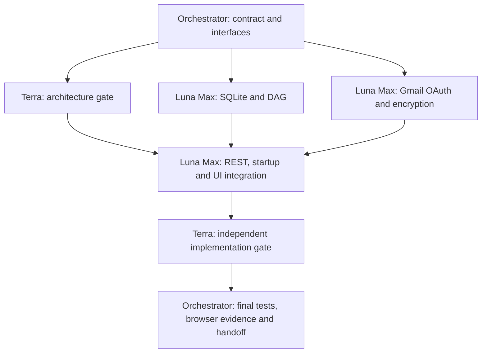

# Emar 0.3.0b — implementation contract

User authorization: rename the service to Emar, implement external Gmail login/connect, persistent database and execution DAG state. The user confirmed Luna Max and Terra are the **development team**, not runtime model providers. Implementation is authorized; no additional specification approval is requested.

Complexity C-3. Risk HIGH: OAuth, durable execution state and provider side effects.

## Scope

- Product/service name becomes **Emar**. Keep the existing `emailmar` directory, imports and legacy environment aliases for compatibility; service naming does not migrate scope identifiers.
- Default local persistence becomes SQLite using the installed Node.js 24 runtime. Minimum Node.js is raised to 22.13 for built-in `node:sqlite`; no external database daemon is required. Keep the in-memory adapter for deterministic tests.
- Persist templates, contacts/consent, suppression, campaign snapshots, queue/idempotency, quota, tracking events, audit, encrypted Gmail connection records and DAG runs.
- A single service process owns a database at a time. Parallel asynchronous workers share that owner; this release is not a distributed multi-host queue.
- The existing 500-message UTC-day ceiling is service-wide across tenant/business scopes. Quota counters are intentionally shared; campaign, recipient, connection and DAG records remain scoped. Per-tenant 500-message pools would exceed the approved service ceiling.
- Gmail login connects the sending account to the existing local operator scope. It does not replace local OS authentication or introduce a multi-tenant Google login authority.
- Store dependency-aware DAG execution state, worker claims and human gates. The DAG cannot approve campaigns or invoke Gmail. No runtime LLM provider is configured or required.

## Development workflow and leases

Source paths have one worker owner at a time. The orchestrator owns contracts, coordination, evidence and final gate, not overlapping source edits. Failures return to the owning worker. A passing unit suite is not a substitute for Terra review or live Gmail evidence.

## Persistence invariants

1. Durable state transitions and their audit entries commit atomically. Database write failure prevents further execution until recovery.
2. Quota accounting, tracking references and send intent commit **before** Gmail is invoked.
3. A crash leaving `sending` persisted becomes `SEND_UNKNOWN` on reopen, with conservative quota accounting and no automatic resend.
4. Approval/template/attachment immutability is restored after database reload.
5. Tenant/business scope remains enforced for both REST and MCP, plus all DAG and connection lookups.
6. Running DAG claims have fencing tokens. Interrupted runs require explicit authorized recovery, not an implicit retry of unknown work.

## OAuth invariants

Initiation requires an authenticated human, same-origin CSRF protection and `integration.write`. Google redirects return to a fixed callback route. A short-lived HttpOnly SameSite=Lax nonce cookie binds the callback to its initiating browser; state resolves context only from server-owned pending data. One-time state, PKCE and bounded expiry prevent replay. Restart invalidates incomplete OAuth attempts.

Tokens are encrypted with AES-256-GCM and scope-bound authenticated data. Encryption key and OAuth client configuration come from process configuration, never source files, audit, browser responses or chat. No plaintext credential fallback is permitted. The UI displays safe connection metadata and missing configuration names only.

Connection identity (`connectionId`, verified Google subject and verified email) is pinned to the approval snapshot. Connecting/reconnecting a sender or changing accounts requires a fresh human approval. Token refresh preserves the connection identity. Refresh/disconnect races cannot resurrect a disconnected connection.

## External setup and evidence boundary

Implementation and fixture tests do not constitute Gmail connection evidence. The Google OAuth client, redirect URI and user consent must be configured before live login; the user performs account login/consent. No live email is sent as part of this development task. Public unsubscribe/tracking reachability, Gmail provider reconciliation, Pub/Sub and production deployment remain separate configuration work.

Sources used for implementation:

- [Node.js SQLite API](https://nodejs.org/download/release/latest-v24.x/docs/api/sqlite.html)
- [Google OAuth web-server flow](https://developers.google.com/identity/protocols/oauth2/web-server)
- [Google OAuth best practices](https://developers.google.com/identity/protocols/oauth2/resources/best-practices)

## Acceptance and final gate

- Existing 24 tests remain green; rename compatibility is explicit.
- Restart retains records, audit, snapshots, consent, queue and DAG state.
- Competing database owners are refused, and uncertain sends do not resend after restart.
- OAuth fixtures cover state replay/binding/expiry, scopes, encrypted storage, refresh, revocation and redacted errors.
- DAG fixtures cover cycle rejection, scope denial, parallel independent claims, dependency fences, human gates and restart recovery.
- REST integration tests cover local callback handling, session/CSRF rules and safe readiness metadata.
- Browser evidence verifies Emar branding, persistent-storage messaging, Gmail connection controls, and the DAG view.
- `npm test` and `npm run check` pass on the final files. Terra reports its gate verdict; the orchestrator separately reports final acceptance and any missing live configuration.
